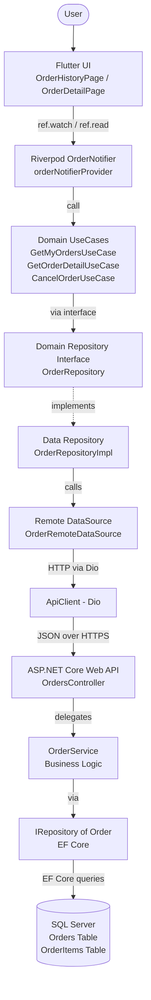

# Order Feature — Implementation Guide

Tài liệu này mô tả toàn bộ thiết kế, kiến trúc, và hướng dẫn vận hành của **Order Feature** trong dự án **Calendar Shop**.
Feature này bao gồm: xem danh sách đơn hàng, xem chi tiết đơn, theo dõi trạng thái và hủy đơn hàng đang chờ xác nhận.

---

## 📋 1. Feature Overview

### Mục đích

Cho phép người dùng đã đăng nhập:
- Xem toàn bộ lịch sử đơn hàng của mình.
- Xem chi tiết từng đơn hàng (thông tin khách hàng, sản phẩm, thanh toán).
- Theo dõi tiến trình trạng thái đơn hàng bằng timeline trực quan.
- Hủy đơn hàng đang ở trạng thái **Pending** (chờ xác nhận).

### User Flow

```
User (đã đăng nhập)
      │
      ▼
  Màn hình Product List
  [tap icon 🧾 ở AppBar]
      │
      ▼
  /orders — Order History Page
  [Danh sách đơn hàng dạng card]
      │
      ├── [Tap vào card]
      │         ▼
      │   /orders/:id — Order Detail Page
      │   [Chi tiết đơn + Timeline trạng thái]
      │         │
      │         ├── Order Tracking Widget
      │         │   [Hiển thị tiến trình: Pending → Confirmed → Shipping → Delivered]
      │         │
      │         └── [Nếu status = Pending]
      │               ▼
      │           Dialog: "Hủy đơn hàng?"
      │           [Nhập lý do + Xác nhận]
      │               ▼
      │           PUT /api/orders/{id}/cancel
      │               ▼
      │           Status → Cancelled
      │           Tracking → Cancelled timeline
      │
      └── [Pull-to-refresh]
            Reload danh sách
```

### Completed Functions

| # | Feature | Route | Status |
|---|---|---|---|
| 1 | Order History | `/orders` | ✅ Done |
| 2 | Order Detail | `/orders/:id` | ✅ Done |
| 3 | Order Tracking Timeline | (widget inside Detail) | ✅ Done |
| 4 | Cancel Pending Order | Dialog inside Detail | ✅ Done |

---

## 🏗️ 2. Architecture Flow

### Full Data Flow Diagram



### Backend Layer Responsibilities

| Layer | File | Responsibility |
|---|---|---|
| **Controller** | `OrdersController.cs` | Nhận HTTP request, validate JWT `[Authorize]`, gọi `IOrderService`, trả về HTTP response. Không chứa business logic. |
| **Service** | `OrderService.cs` | Toàn bộ business logic: kiểm tra quyền, validate status, tính toán, map DTO. Throw exception nếu có lỗi. |
| **Repository** | `IRepository<Order>` | Truy cập database qua Entity Framework Core. Trả về `IQueryable<T>` để lazy-load. |
| **Database** | SQL Server | Lưu trữ bảng `Orders` và `OrderItems`. |

### Flutter Layer Responsibilities

| Layer | Responsibility |
|---|---|
| **UI (Pages/Widgets)** | Render dữ liệu, handle user interactions. Chỉ gọi provider qua `ref.watch` / `ref.read`. Không gọi API/Repository. |
| **Riverpod Provider** | `OrderNotifier` quản lý `OrderState`. Gọi UseCase, cập nhật state (`isLoading`, `orders`, `selectedOrder`, `error`). |
| **UseCase** | Đóng gói một nghiệp vụ cụ thể. Nhận input từ Provider, gọi Repository interface. |
| **Repository Interface** | Định nghĩa contract sạch trong Domain. Không phụ thuộc vào Data layer. |
| **Repository Impl** | Implement interface, gọi DataSource, convert Model → Entity. |
| **Remote DataSource** | Thực hiện HTTP call qua `ApiClient` (Dio). Parse JSON thành Model. |
| **ApiClient** | Cấu hình Dio với `baseUrl`, `Authorization header`, `handleError`. |

---

## 🖥️ 3. Backend Files

### Entity Models (`Models/`)

#### `Order.cs`
```csharp
public class Order {
    public int OrderId { get; set; }
    public int UserId { get; set; }
    public int? CouponId { get; set; }
    public string CustomerName { get; set; }
    public string CustomerPhone { get; set; }
    public string ShippingAddress { get; set; }
    public decimal SubTotal { get; set; }
    public decimal DiscountAmount { get; set; }
    public decimal ShippingFee { get; set; }
    public decimal TotalAmount { get; set; }
    public string PaymentMethod { get; set; } = "COD";
    public string Status { get; set; } = "Pending";
    public string? Note { get; set; }
    public string? CancelReason { get; set; }
    public DateTime CreatedAt { get; set; }
    public DateTime? UpdatedAt { get; set; }

    // Navigation properties
    public User? User { get; set; }
    public Coupon? Coupon { get; set; }
    public ICollection<OrderItem> OrderItems { get; set; }
}
```

**Quan hệ:** `Order` có quan hệ **1-nhiều** với `OrderItem` qua `OrderItems`. Mỗi `OrderItem` giữ `OrderId` (FK) và `ProductId` (FK).

#### `OrderItem.cs`
```csharp
public class OrderItem {
    public int OrderItemId { get; set; }
    public int OrderId { get; set; }       // FK → Order
    public int ProductId { get; set; }     // FK → Product
    public string ProductName { get; set; }
    public string? ProductImageUrl { get; set; }
    public decimal UnitPrice { get; set; }
    public int Quantity { get; set; }
    public decimal TotalPrice { get; set; } // = UnitPrice × Quantity

    // Navigation
    public Order? Order { get; set; }
    public Product? Product { get; set; }
}
```

---

### Controller (`Controllers/OrdersController.cs`)

```
[Authorize]
POST   /api/orders              → Create(CreateOrderRequest)
GET    /api/orders/mine         → Mine()              [EnableQuery - OData]
GET    /api/orders/{id}         → GetById(int id)
PUT    /api/orders/{id}/cancel  → Cancel(int id, CancelOrderRequest)

[Authorize(Roles = "Admin")]
GET    /api/orders/admin        → AdminGetAll()        [EnableQuery]
PUT    /api/orders/admin/{id}/status → AdminUpdateStatus(int id, ...)
```

**Quy tắc:** Controller chỉ gọi `IOrderService`. Mọi lỗi được throw từ Service và được xử lý bởi Global Exception Middleware.

---

### Service (`Services/OrderService.cs`)

**Business logic được thực hiện:**
- `GetMyOrdersQuery`: Lọc các Order theo `UserId`, project sang `OrderDto` qua AutoMapper.
- `GetOrderByIdAsync`: Kiểm tra Order tồn tại và thuộc về `UserId`. Throw `KeyNotFoundException` nếu không tìm thấy.
- `CancelOrderAsync`: Kiểm tra Order thuộc về user. Kiểm tra `Status == "Pending"` — throw `BadHttpRequestException` nếu không hợp lệ. Cập nhật `Status = "Cancelled"` và `CancelReason`.

---

### DTOs (`Dtos/OrderDtos.cs`)

| DTO | Fields | Dùng khi |
|---|---|---|
| `OrderDto` | OrderId, UserId, CustomerName, Phone, Address, SubTotal, DiscountAmount, ShippingFee, TotalAmount, PaymentMethod, Status, Note, CreatedAt, Items | API Response |
| `OrderItemDto` | OrderItemId, ProductId, ProductName, ProductImageUrl, UnitPrice, Quantity, TotalPrice | Nested trong OrderDto |
| `CancelOrderRequest` | `string? Reason` | PUT /cancel request body |
| `CreateOrderRequest` | CustomerName, Phone, Address, PaymentMethod, CouponCode?, Note? | POST request body |

---

## 📱 4. Flutter Files

### Full File Structure

```
lib/features/order/
├── domain/
│   ├── entities/
│   │   ├── order_entity.dart           ← Clean entity, no JSON logic
│   │   └── order_item_entity.dart      ← Clean entity for order item
│   ├── repositories/
│   │   └── order_repository.dart       ← Abstract interface
│   └── usecases/
│       ├── get_my_orders_usecase.dart
│       ├── get_order_detail_usecase.dart
│       └── cancel_order_usecase.dart
├── data/
│   ├── models/
│   │   ├── order_model.dart            ← JSON serializable, has toEntity()
│   │   └── order_item_model.dart       ← JSON serializable, has toEntity()
│   ├── datasources/
│   │   └── order_remote_datasource.dart ← Dio HTTP calls
│   └── repositories/
│       └── order_repository_impl.dart  ← Converts Model → Entity
└── presentation/
    ├── providers/
    │   ├── order_provider.dart         ← OrderNotifier + generated providers
    │   ├── order_provider.g.dart       ← Generated by riverpod_generator
    │   ├── order_state.dart            ← Freezed OrderState
    │   └── order_state.freezed.dart    ← Generated by freezed
    ├── pages/
    │   ├── order_history_page.dart     ← Route: /orders
    │   ├── order_detail_page.dart      ← Route: /orders/:id
    │   └── my_orders_page.dart         ← Router alias → OrderHistoryPage
    └── widgets/
        ├── order_card_widget.dart          ← Tappable list card
        ├── order_status_badge_widget.dart  ← Status pill badge
        ├── order_item_card_widget.dart     ← Single item in detail
        └── order_tracking_widget.dart      ← Timeline progress widget
```

### File Responsibilities

#### Domain Layer

| File | Responsibility |
|---|---|
| `order_entity.dart` | Freezed entity. Fields: `orderId`, `userId`, `customerName`, `customerPhone`, `shippingAddress`, `subTotal`, `discountAmount`, `shippingFee`, `totalAmount`, `paymentMethod`, `status`, `note?`, `cancelReason?`, `createdAt`, `updatedAt?`, `items`. |
| `order_item_entity.dart` | Freezed entity. Fields: `orderItemId`, `productId`, `productName`, `productImageUrl?`, `unitPrice`, `quantity`, `totalPrice`. |
| `order_repository.dart` | Abstract interface: `getMyOrders()`, `getOrderDetail(id)`, `cancelOrder(id, reason)`. Domain layer không biết về implementation. |
| `get_my_orders_usecase.dart` | Gọi `repository.getMyOrders()`. |
| `get_order_detail_usecase.dart` | Gọi `repository.getOrderDetail(id)`. |
| `cancel_order_usecase.dart` | Gọi `repository.cancelOrder(id, reason)`. |

#### Data Layer

| File | Responsibility |
|---|---|
| `order_model.dart` | Freezed + JSON serializable. Có `fromJson()` và `toEntity()` để convert sang `OrderEntity`. |
| `order_item_model.dart` | Freezed + JSON serializable. Có `fromJson()` và `toEntity()` để convert sang `OrderItemEntity`. |
| `order_remote_datasource.dart` | HTTP calls qua `ApiClient.dio`: `getMyOrders()` → `GET /orders/mine`, `getOrderDetail(id)` → `GET /orders/{id}`, `cancelOrder(id, reason)` → `PUT /orders/{id}/cancel`. |
| `order_repository_impl.dart` | Implements `OrderRepository`. Gọi DataSource, convert `OrderModel` → `OrderEntity` qua `toEntity()`. |

#### Presentation Layer

| File | Responsibility |
|---|---|
| `order_state.dart` | Freezed immutable state: `{ isLoading, orders?, selectedOrder?, error? }`. |
| `order_provider.dart` | `@riverpod` providers cho DataSource, Repository, UseCases. `OrderNotifier` với `loadOrders()`, `loadOrderDetail(id)`, `cancelOrder(id, reason)`. |
| `order_history_page.dart` | `ConsumerStatefulWidget`. Gọi `loadOrders()` trong `initState`. Xử lý 4 state: Loading / Error / Empty / Success. Có pull-to-refresh. |
| `my_orders_page.dart` | Router alias: `ConsumerWidget` delegate sang `OrderHistoryPage`. Giữ tên cho `app_router.dart` compat. |
| `order_detail_page.dart` | `ConsumerStatefulWidget`. Gọi `loadOrderDetail(id)` trong `initState`. Hiển thị status banner, order info, tracking, shipping, items, payment, cancel button. Chứa `_CancelOrderDialog`. |
| `order_card_widget.dart` | `StatelessWidget(order: OrderEntity)`. Render card với ID, ngày, item count, tổng tiền, status badge. `onTap` → `context.push('/orders/${order.orderId}')`. |
| `order_status_badge_widget.dart` | `StatelessWidget(status: String)`. Map status → Vietnamese label + màu + icon. |
| `order_item_card_widget.dart` | `StatelessWidget(item: OrderItemEntity)`. Render thumbnail, tên, đơn giá, quantity badge, tổng tiền. |
| `order_tracking_widget.dart` | `StatelessWidget(status: String)`. Render vertical timeline. Normal flow: 4 bước. Cancelled flow: 2 bước (Pending → Cancelled / đỏ). |

---

## 🔌 5. API List

| Method | Endpoint | Auth | Purpose |
|---|---|---|---|
| `GET` | `/api/orders/mine` | JWT (User) | Lấy danh sách đơn hàng của user hiện tại |
| `GET` | `/api/orders/{id}` | JWT (User) | Lấy chi tiết một đơn hàng theo ID |
| `PUT` | `/api/orders/{id}/cancel` | JWT (User) | Hủy đơn hàng (chỉ khi Pending) |

### Chi tiết API

#### GET `/api/orders/mine`
- **Headers:** `Authorization: Bearer <token>`
- **OData:** Hỗ trợ `$filter`, `$orderby`, `$top`, `$skip`
- **Response 200:**
```json
[
  {
    "orderId": 1,
    "userId": 5,
    "customerName": "Nguyễn Văn A",
    "customerPhone": "0901234567",
    "shippingAddress": "123 Đường ABC, Q.1, TP.HCM",
    "subTotal": 365000,
    "discountAmount": 15000,
    "shippingFee": 30000,
    "totalAmount": 380000,
    "paymentMethod": "COD",
    "status": "Pending",
    "note": null,
    "createdAt": "2026-06-28T03:00:00Z",
    "items": [ ... ]
  }
]
```

#### GET `/api/orders/{id}`
- **Response 200:** Single `OrderDto` (same structure as above)
- **Response 404:** Order không tồn tại hoặc không thuộc về user

#### PUT `/api/orders/{id}/cancel`
- **Headers:** `Authorization: Bearer <token>`
- **Request Body:**
```json
{ "reason": "Không cần nữa" }
```
- **Response 204:** No Content (thành công)
- **Response 400:** Order không ở trạng thái Pending
- **Response 404:** Order không tìm thấy / không thuộc user

---

## ⚙️ 6. State Management (Riverpod)

### OrderState

```dart
@freezed
class OrderState with _$OrderState {
  const factory OrderState({
    @Default(false) bool isLoading,
    List<OrderEntity>? orders,       // null = chưa load, [] = empty
    OrderEntity? selectedOrder,
    String? error,
  }) = _OrderState;
}
```

### State Transition Flow

```
Initial:  { isLoading: false, orders: null, error: null }

loadOrders() called:
  → { isLoading: true, error: null }          ← UI shows spinner
  → [API call...]
  → Success: { isLoading: false, orders: [...] }  ← UI shows list
  → Failure: { isLoading: false, error: "..." }   ← UI shows error

loadOrderDetail(id) called:
  → { isLoading: true, error: null }
  → Success: { isLoading: false, selectedOrder: order }
  → Failure: { isLoading: false, error: "..." }

cancelOrder(id, reason) called:
  → { isLoading: true, error: null }
  → Success: reload orders + reload detail
  → Failure: { isLoading: false, error: "..." }
```

### UI State Handling Pattern

```dart
// In ConsumerStatefulWidget:
final orderState = ref.watch(orderNotifierProvider);

if (orderState.isLoading)   → CircularProgressIndicator
if (orderState.error != null) → Error widget + Retry button
if (orders.isEmpty)         → Empty state widget
else                        → Success: render list / detail
```

---

## 🖼️ 7. UI Flow

### Screen 1: Order History (`/orders`)

**Components:**
- `AppBar` — "Đơn hàng của tôi" với refresh button
- Gradient accent bottom strip
- Summary header: `N đơn hàng`
- `ListView` of `OrderCardWidget`

**`OrderCardWidget` displays:**
- Header strip: `Đơn #N` + `OrderStatusBadgeWidget`
- Body: Customer name, created date, item count
- Footer: Divider + Total amount + chevron →

**Navigation:** Tap card → `context.push('/orders/${orderId}')`

---

### Screen 2: Order Detail (`/orders/:id`)

**Sections (top to bottom):**

| Section | Widget/Method | Content |
|---|---|---|
| AppBar | `_buildAppBar` | "Chi tiết đơn hàng" + `#ORD001` |
| Status Banner | `_buildStatusBanner` | Gradient blue, `OrderStatusBadgeWidget`, order ID, date |
| Thông tin đơn hàng | `_buildSection` | Mã đơn, ngày đặt, ghi chú, lý do hủy |
| **Order Tracking** | `OrderTrackingWidget` | Vertical timeline trạng thái |
| Địa chỉ giao hàng | `_buildSection` | Tên, SĐT, địa chỉ |
| Sản phẩm (N) | `_buildSection` + `OrderItemCardWidget` | Danh sách sản phẩm |
| Tóm tắt thanh toán | `_buildSection` | Tạm tính, giảm giá, phí ship, **Tổng tiền (bold blue)** |
| Phương thức TT | `_buildSection` | Icon + tên method + chevron |
| Cancel Button | `Positioned` (Pending only) | Red full-width button |

---

### Screen 3: Order Tracking Widget

**Normal flow steps:**

```
Pending    (Chờ xác nhận)   → step 1
Confirmed  (Đã xác nhận)    → step 2
Shipping   (Đang giao hàng) → step 3
Delivered  (Đã giao hàng)   → step 4
```

**Cancelled flow:**
```
Pending    (Chờ xác nhận) → completed (blue ✓)
Cancelled  (Đã hủy)       → active (RED glow)
```

**Step visual states:**
- `completed`: Filled blue circle, blue connector, ✓ check icon
- `active`: Filled circle with glow shadow, `Hiện tại` badge
- `inactive`: Grey outline circle, grey connector

---

### Screen 4: Cancel Order Dialog

**Trigger:** Tap "Hủy đơn hàng" button (chỉ hiện khi `status == "Pending"`)

**Dialog content:**
- Title: ⚠️ "Hủy đơn hàng?"
- Body: "Bạn có chắc muốn hủy đơn này không?"
- TextField: Label "Lý do hủy đơn", hint "Lý do hủy đơn"
- Validation: Empty reason → hiện inline error "Vui lòng nhập lý do hủy"
- Buttons: [Đóng] | [Xác nhận hủy] (red)

**Business rule:**
| Status | Cancel Button |
|---|---|
| Pending | ✅ Shown |
| Confirmed | ❌ Hidden |
| Shipping | ❌ Hidden |
| Delivered | ❌ Hidden |
| Cancelled | ❌ Hidden |

---

## 🚀 8. How To Run

### Flutter (Mobile App)

```bash
cd mobile_flutter

# 1. Install dependencies
flutter pub get

# 2. Re-generate code (Freezed + Riverpod) — chạy khi thay đổi entity/provider
dart run build_runner build --delete-conflicting-outputs

# 3. Run app (debug mode)
flutter run
```

**Requirements:**
- Flutter SDK >= 3.4.0
- Dart SDK >= 3.4.0
- Android/iOS device hoặc emulator

### Backend (ASP.NET Core API)

```bash
cd backend_api/CalendarShop.Api

# Run with development settings
dotnet run --launch-profile Development
```

**Requirements:**
- .NET 8 SDK
- SQL Server (local hoặc Docker)
- Connection string đúng trong `appsettings.Development.json`
- Database đã migrate: `dotnet ef database update`

**Authentication:**
- API dùng JWT Bearer token
- Login qua `POST /api/auth/login` → nhận `accessToken`
- Flutter tự động đính token vào header qua `ApiClient`
- Token hết hạn → logout / đăng nhập lại

---

## ✅ 9. Manual Testing Guide

### 9.1 Test Order History

| Step | Action | Expected Result |
|---|---|---|
| 1 | Login với tài khoản user hợp lệ | Navigate sang `/products` |
| 2 | Tap icon 🧾 (receipt) ở AppBar | Navigate sang `/orders` |
| 3 | Quan sát loading state | CircularProgressIndicator hiển thị |
| 4 | Chờ data load | Danh sách order dạng card xuất hiện |
| 5 | Kiểm tra mỗi card | Order ID, ngày, số sản phẩm, tổng tiền, status badge đúng |
| 6 | Pull-to-refresh | Danh sách reload |
| 7 | Nếu user chưa có order | Empty state: "Chưa có đơn hàng nào" |

---

### 9.2 Test Order Detail

| Step | Action | Expected Result |
|---|---|---|
| 1 | Tap vào bất kỳ order card | Navigate sang `/orders/{id}` |
| 2 | Kiểm tra AppBar | "Chi tiết đơn hàng" + `#ORD00X` |
| 3 | Kiểm tra Status Banner | Gradient blue, badge đúng status, ID, ngày |
| 4 | Kiểm tra "Thông tin đơn hàng" | Mã đơn, ngày đặt hiển thị đúng |
| 5 | Kiểm tra "Địa chỉ giao hàng" | Tên, SĐT, địa chỉ đúng |
| 6 | Kiểm tra danh sách sản phẩm | Ảnh/placeholder, tên, giá, số lượng, tổng đúng |
| 7 | Kiểm tra "Tóm tắt thanh toán" | Subtotal, discount (nếu có), ship fee, total đúng và định dạng `đ` |
| 8 | Tap nút Back | Trở về `/orders`, không crash |

---

### 9.3 Test Order Tracking

Thay đổi status trong DB hoặc dùng Admin API để test từng trạng thái:

| Status | Expected Timeline |
|---|---|
| `Pending` | Bước 1 (Chờ xác nhận) active, bước 2-4 grey |
| `Confirmed` | Bước 1 completed (✓), bước 2 active, bước 3-4 grey |
| `Shipping` | Bước 1-2 completed, bước 3 (Đang giao hàng) active, bước 4 grey |
| `Delivered` | Cả 4 bước completed (✓ blue), bước 4 có "Hiện tại" badge |
| `Cancelled` | Bước 1 completed, bước 2 (Đã hủy) RED active |

**Kiểm tra visual:**
- Active step có glow shadow trên dot
- Active step có badge "Hiện tại" bên phải
- Cancelled step: dot, label, badge đều màu đỏ

---

### 9.4 Test Cancel Order

**Test Case 1 — Hủy thành công (Pending order):**

| Step | Action | Expected |
|---|---|---|
| 1 | Mở detail một Pending order | Button "Hủy đơn hàng" (đỏ) hiển thị ở dưới |
| 2 | Tap button | Dialog "Hủy đơn hàng?" mở |
| 3 | Nhập lý do: "Không cần nữa" | TextField có nội dung |
| 4 | Tap "Xác nhận hủy" | Button disable, spinner hiển thị |
| 5 | API call thành công | Dialog đóng |
| 6 | Sau dialog | SnackBar xanh "Hủy đơn hàng thành công" |
| 7 | Kiểm tra status badge | "Đã hủy" (grey) |
| 8 | Kiểm tra tracking | Timeline: Pending (✓) → Cancelled (RED) |
| 9 | Kiểm tra cancel button | Đã biến mất |

**Test Case 2 — Order không phải Pending:**

| Status | Expected |
|---|---|
| Confirmed | Không thấy button "Hủy đơn hàng" |
| Shipping | Không thấy button |
| Delivered | Không thấy button |
| Cancelled | Không thấy button |

**Test Case 3 — Lý do rỗng:**

| Step | Action | Expected |
|---|---|---|
| 1 | Mở dialog cancel | TextField trống |
| 2 | Tap "Xác nhận hủy" ngay | Dialog KHÔNG đóng |
| 3 | Inline error | "Vui lòng nhập lý do hủy" xuất hiện dưới TextField (đỏ) |
| 4 | API không được gọi | Không có network request |
| 5 | Nhập lý do | Error text tự động biến mất |

**Test Case 4 — Backend offline:**

| Step | Action | Expected |
|---|---|---|
| 1 | Dừng backend server | - |
| 2 | Mở Order History | Error state: "Không thể tải đơn hàng" + nút "Thử lại" |
| 3 | Mở Order Detail | Error state tương tự |
| 4 | Thử cancel | SnackBar đỏ "Không thể hủy đơn hàng. Vui lòng thử lại." |
| 5 | App không crash | ✅ |

---

## 🐛 10. Common Errors & Solutions

| Error | Cause | Solution |
|---|---|---|
| `Could not run build_runner` | Generated files conflict | `dart run build_runner build --delete-conflicting-outputs` |
| `401 Unauthorized` | JWT token hết hạn | Logout và login lại; Flutter sẽ tự lấy token mới |
| `404 Not Found` khi get order | Order không tồn tại hoặc thuộc user khác | Kiểm tra `orderId` và user đang đăng nhập |
| `400 Bad Request` khi cancel | Order không ở trạng thái Pending | UI đã chặn — chỉ xảy ra nếu backend state desync |
| `Null` hiện thay vì data | `OrderModel.fromJson` không map đúng field | Kiểm tra field name trong JSON vs model (camelCase) |
| `type 'Null' is not a subtype` | Backend trả field không expected | Dùng `?` nullable type trong model, kiểm tra mapper |
| `DioException: Connection refused` | Backend không chạy hoặc sai baseUrl | Kiểm tra `ApiConstants.baseUrl` khớp với server đang chạy |
| Tracking không update sau cancel | `loadOrderDetail` chưa được gọi sau cancel | `OrderNotifier.cancelOrder()` đã gọi `loadOrders()` + `loadOrderDetail()` — kiểm tra provider |
| Freezed classes không compile | `*.freezed.dart` cũ | Chạy lại `build_runner build` |

---

## 🔮 11. Future Extensions

Các tính năng có thể mở rộng trong tương lai:

| Feature | Description | Priority |
|---|---|---|
| **Order Search** | Tìm kiếm đơn hàng theo ID hoặc tên sản phẩm | Medium |
| **Filter by Status** | Lọc danh sách theo trạng thái (tabs: Pending / Active / Completed) | High |
| **Filter by Date Range** | Lọc theo khoảng thời gian tạo đơn | Medium |
| **Pagination** | OData `$top`/`$skip` paging thay vì load all | High |
| **Push Notifications** | Thông báo khi order status thay đổi (FCM) | High |
| **Real-time Tracking** | WebSocket / SignalR để cập nhật status real-time | Medium |
| **Order Reorder** | Đặt lại đơn hàng cũ với cùng sản phẩm | Low |
| **Admin Order Management** | Màn hình admin để xem tất cả orders, cập nhật status | High |
| **Payment Integration** | Tích hợp VNPay / MoMo thay cho COD | High |
| **Order Rating** | Đánh giá sản phẩm sau khi order Delivered | Low |
| **Invoice Export** | Xuất hóa đơn PDF | Low |

---

## 📄 Related Documentation

| File | Content |
|---|---|
| [`ORDER_PROVIDER_GUIDE.md`](../ORDER_PROVIDER_GUIDE.md) | Chi tiết về Riverpod provider, state flow |
| [`ORDER_HISTORY_GUIDE.md`](../ORDER_HISTORY_GUIDE.md) | Order History page & widgets |
| [`ORDER_DETAIL_GUIDE.md`](../ORDER_DETAIL_GUIDE.md) | Order Detail page & sections |
| [`ORDER_TRACKING_GUIDE.md`](../ORDER_TRACKING_GUIDE.md) | Tracking widget & timeline logic |
| [`ORDER_CANCEL_GUIDE.md`](../ORDER_CANCEL_GUIDE.md) | Cancel feature, validation, error handling |
| [`developer_guide.md`](developer_guide.md) | Global architecture standards |
